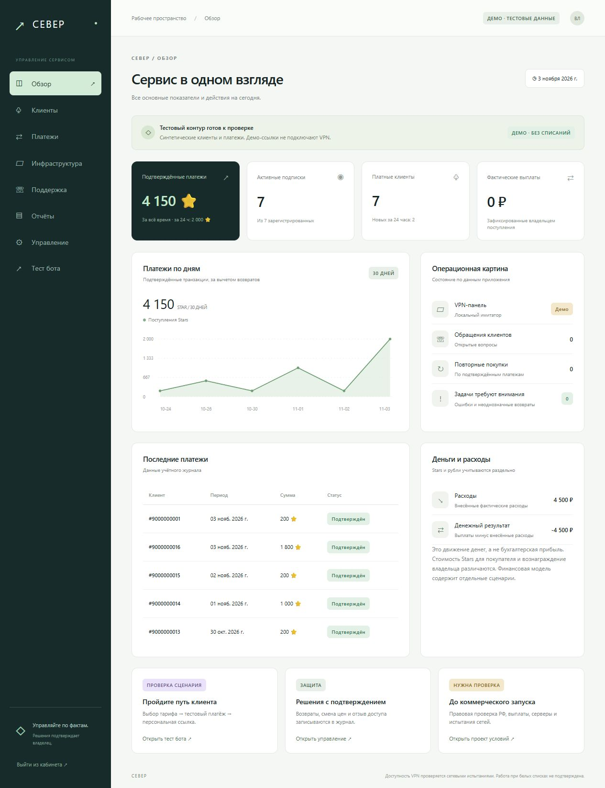

# A.L.L. VPN

Личный прототип Telegram-бота с подписками и кабинетом владельца. Я сформулировал сценарии оформления и продления подписки, управления доступом и просмотра платежей. Прототип собирался с Codex. В исходном проекте использованы Python, FastAPI, SQLite, HTML, CSS и JavaScript.

Откройте [index.html](index.html). В демонстрации можно выбрать тариф, провести условную оплату, увидеть изменение статуса подписки и журнала. Кабинет использует стили и график из исходного проекта. Данные и операции моделируются в браузере, сбрасываются при перезагрузке и не обращаются к внешним сервисам. Действующая VPN-инфраструктура и интеграции в эту сборку не входят.

Кабинет владельца в исходном тестовом прототипе, когда проект назывался «Север».

