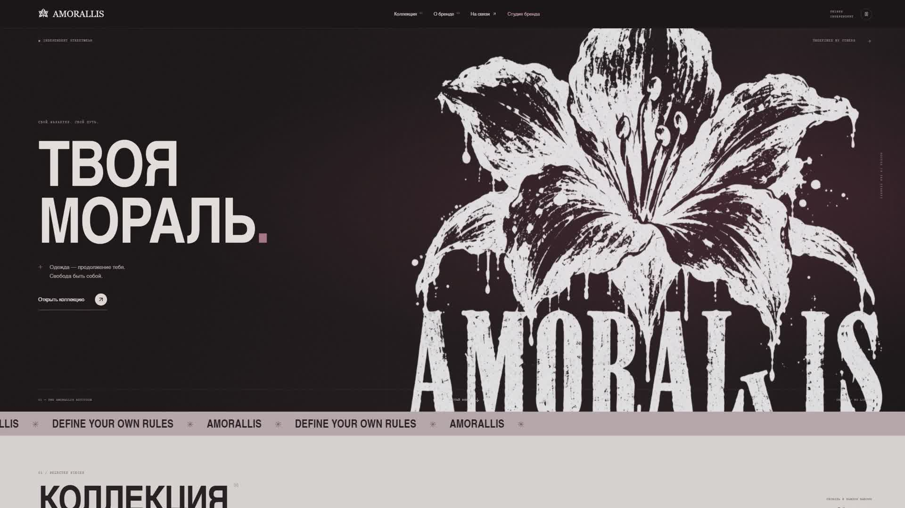

# AMORALLIS

Концепт сайта для streetwear. Задача — представить коллекцию и айдентику бренда в одной адаптивной витрине.

Я сформулировал требования к оформлению, поведению эмблемы при прокрутке и анимации капель. Работал над итерациями прототипа с ИИ-инструментами ChatGPT и Codex. Публикация выполнена через Sites.

Откройте [витрину AMORALLIS](https://amorallis.vast-acorn-4083.chatgpt.site/) и перейдите к коллекции или откройте меню на узком экране. На витрине представлен концепт первого дропа. Для локального просмотра доступен [видеообзор](walkthrough.mp4). Исходный каталог файлов пока недоступен в этой копии.

