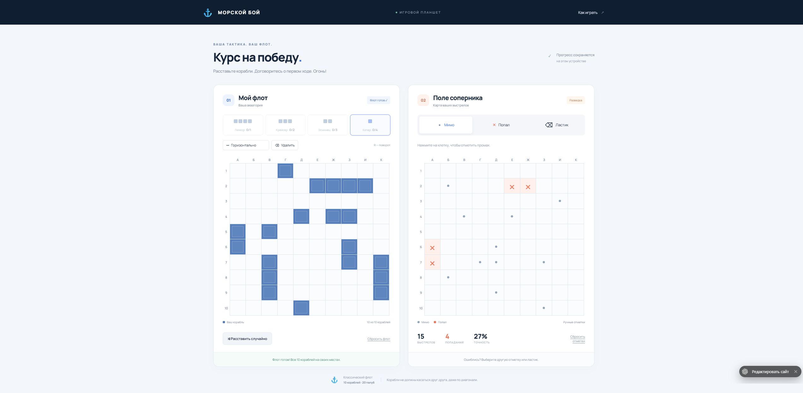

# Морской бой

Браузерный планшет для настольной игры. Я задал правила расстановки, сценарии отметки попаданий и требования к мобильному интерфейсу, затем собрал прототип с Codex.

Откройте [dist/index.html](dist/index.html) в браузере. На своей доске можно расставить корабли вручную или автоматически, повернуть или удалить корабль. На второй доске можно отметить попадание или промах и исправить отметку. Данные сохраняются на этом устройстве.

Скачайте [однофайловую версию](standalone.html) и откройте её в браузере. Внутри файла уже есть стили и игровая логика, поэтому игра работает без интернета.

Стек — HTML, CSS, JavaScript и localStorage. Проверка правил и сохранения состояния запускается из этой папки командой `node check.cjs`.

