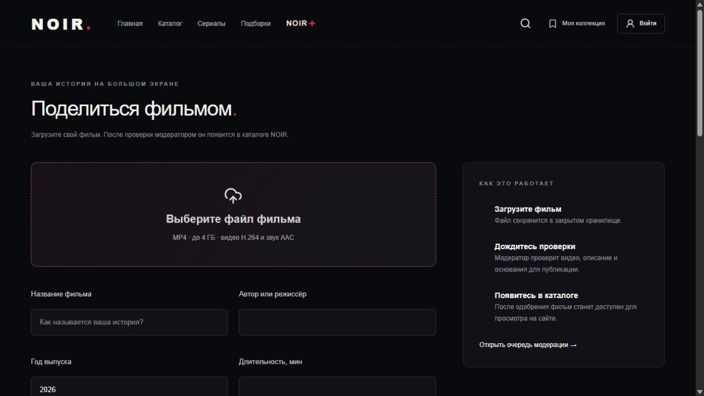

# NOIR

Веб-прототип онлайн-кинотеатра. Я сформулировал сценарии афиши, поиска, фильтрации, карточки фильма и плеера и дорабатывал их с Codex. Исходный проект использует Next.js, React, TypeScript, Three.js, NestJS и Prisma.

Откройте [index.html](index.html). В портфолио доступен фрагмент каталога с вымышленными фильмами. Поиск по названию, режиссёру или актёрам использует логику нечёткого совпадения из исходного проекта. Попробуйте ввести «Спктр» или выбрать жанр. Обложки этой демонстрации нарисованы средствами CSS. Плеер, аккаунты и платежи в демосборку не входят.

Форма загрузки из исходного прототипа.

